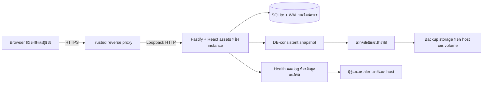

# CareFlow — Cloud production foundation

วันที่ตรวจ: 2 ตุลาคม 2026 · สถานะ: **แบบเสนอเพื่อทบทวน ยังไม่ได้อนุมัติ implementation plan หรือเปิดใช้งานจริง**

## 1. เป้าหมายและขอบเขตการตัดสินใจ

เตรียมเว็บสำหรับคลินิกขนาดเล็ก มีหมอฝนหนึ่งคนและผู้ช่วยหนึ่งคน ใช้บัญชีแยก สิทธิ์แยก และฐานข้อมูลหลักบน cloud เพียงชุดเดียว ข้อเสนอคือคง React + Fastify + SQLite เป็นแอปที่ทำงานต่อเนื่องบนเครื่อง cloud หนึ่งเครื่อง มีดิสก์ถาวร HTTPS และสำเนาสำรองเข้ารหัสนอกเครื่อง พร้อมพิสูจน์การกู้คืนและป้องกันงานซ้ำด้วยข้อมูลสังเคราะห์ก่อนใช้ข้อมูลจริง

**สิ่งที่ผู้ใช้เลือกแล้ว:** พัฒนาเพื่อความพร้อมใช้งานจริงโดยตรง ไม่เพิ่มระยะ demo แยก; เมื่ออินเทอร์เน็ตล่มใช้กระดาษ/ระบบเดิมชั่วคราว; ไม่ทำ offline sync สองทางในรุ่นแรก; telemedicine เลื่อนออกไป; ต้องการย้ายข้อมูลเดิม แต่ให้รอการเข้าถึงและรูปแบบ export ก่อนตรวจระบบนั้น ใช้ Mac ที่เชื่อมต่ออยู่เป็นเครื่องพัฒนาได้ คำว่า cloud หมายถึงที่ให้บริการผลิตภัณฑ์

**ข้อเสนอที่ขอให้ทบทวนในเอกสารนี้:** สถาปัตยกรรมด้านล่าง ขอบเขตสิทธิ์เดิม วิธีจัดการคำขอที่ไม่ทราบผล การสำรอง/กู้คืน และลำดับขอบเขตงาน F1–F5 ไม่ใช่การเลือกผู้ให้บริการ ซื้อบริการ สร้าง credential ถาวร deploy รวม PR นำเข้าข้อมูลจริง หรืออนุมัติ go-live

แบบนี้แทนข้อเสนอ *Windows เป็น server หลักใน LAN* ใน [แบบวันที่ 20 กันยายน](2026-09-20-careflow-clinic-production-trial-design.md) ตามทิศทาง cloud ล่าสุด Windows ยังเป็นเครื่อง browser/พิมพ์/สแกนได้ ข้อเสนอเรื่อง trial/บันทึกคู่ขนานในเอกสารเดิมไม่ถูกถือว่าอนุมัติไว้แล้ว ต้องกำหนดอีกครั้งใน cutover เมื่ออนุมัติเปิดใช้ CareFlow จะเป็นแหล่งหลักสำหรับขอบเขตงานที่ตัดย้ายมา ระบบเดิมใช้ค้นประวัติหรือเป็น fallback ตามที่อนุมัติ ไม่มีฐาน CareFlow อีกชุดที่คลินิกให้เขียนแข่งกัน

## 2. ฐานโค้ดที่ตรวจจริง

[PR3](https://github.com/ajbk/careflow-clinic/pull/3) ยังเปิดและยังไม่ merged ณ เวลาตรวจ; head คือ `dce62ea783b3c5eade2e27536b61fcfd941bd645` บน `codex/uat-stability-fixes` ตรงกับ checkout เดิม PR นี้ปัจจุบันไม่ใช่ draft; เอกสารนี้ไม่ได้เปลี่ยนสถานะ PR งาน PR ใหม่ในอนาคตให้เป็น draft จนกว่าจะได้รับคำสั่งอื่น

ลิงก์โค้ดด้านล่างอ้างอิงไฟล์ใน revision ฐานข้างต้น เป็นสิ่งที่ตรวจพบ ไม่ใช่ข้อรับรอง production:

| หลักฐาน | สิ่งที่มีอยู่และผลต่อแบบ |
|---|---|
| [config](../../../careflow-pilot/src/server/config.ts), [app](../../../careflow-pilot/src/server/app.ts) | bind ได้เฉพาะ loopback; Secure cookie default เป็น false; Fastify ยังไม่ได้กำหนด trusted proxy; health ตรวจเพียง `SELECT 1` |
| [DB client](../../../careflow-pilot/src/server/db/client.ts), [host lock](../../../careflow-pilot/src/server/host-lock.ts), [lifecycle](../../../careflow-pilot/src/server/lifecycle.ts) | WAL, synchronous FULL, foreign keys, busy timeout 5 วินาที; ตรวจ identity/migration hashes และ migrate ระหว่างเปิดฐาน; directory lock ต้องจัดการเมื่อ crash |
| [auth](../../../careflow-pilot/src/server/auth/routes.ts), [sessions](../../../careflow-pilot/src/server/modules/platform/sessions.ts), [permissions](../../../careflow-pilot/src/server/modules/platform/permissions.ts) | Argon2id, opaque token เก็บเฉพาะ hash, idle 15 นาที/absolute 8 ชั่วโมง, ตรวจบัญชี active; login throttle เป็น Map ต่อ IP+username ในหน่วยความจำ |
| [audit](../../../careflow-pilot/src/server/modules/platform/audit.ts), [idempotency](../../../careflow-pilot/src/server/modules/platform/idempotency.ts), [platform migration](../../../careflow-pilot/drizzle/0000_platform.sql) | immediate transactions ผูก actor; audit ห้าม update/delete; key ผูก actor และ hash ของ operation/body/scope; domain, audit และผล replay commit ร่วมกัน |
| [fulfillment routes](../../../careflow-pilot/src/server/modules/fulfillment/routes.ts), [dispense ledger](../../../careflow-pilot/drizzle/0011_dispense_ledger.sql), [collection ledger](../../../careflow-pilot/drizzle/0017_charge_collection_ledger.sql) | สิทธิ์แพทย์ปล่อยยา, หลักฐานส่งมอบ/ตัดสต็อก, unique payment ต่อ visit/charge และ append-only guards เป็นฐานที่ต้องรักษา |
| [client attempts](../../../careflow-pilot/src/client/lib/idempotency.ts), [query client](../../../careflow-pilot/src/client/app/query-client.ts) | คำสั่งหนึ่งครั้งใช้ UUID และ payload ที่ freeze; mutation ไม่ retry อัตโนมัติ ยังไม่ใช่ durable offline queue หรือสัญญาการกู้ผลข้าม restore |
| [platform schema](../../../careflow-pilot/src/server/modules/platform/schema.ts), [patient schema](../../../careflow-pilot/src/server/modules/patient/schema.ts), [contracts](../../../careflow-pilot/src/shared/contracts.ts), [users CLI](../../../careflow-pilot/src/server/modules/platform/users-cli.ts) | synthetic-only บังคับใน schema/contract/account flow; HN, ข้อมูลบุคคล และรหัสยา DEMO มีข้อจำกัดจริง ห้ามปลดเพียง flag/ข้อความเตือน |
| [finance](../../../careflow-pilot/src/server/modules/finance/service.ts), [pilot README](../../../careflow-pilot/README.md) | integer บาท, รับเต็มจำนวน/ยกเว้นเต็มจำนวน, ยืนยัน PromptPay ด้วยคน; backup/restore, ใบเสร็จภาษี, คืนเงิน, รับบางส่วน และ bank integration ยังไม่พร้อม |
| [CI](../../../.github/workflows/ci.yml), [finance races](../../../careflow-pilot/tests/server/finance-concurrency.test.ts), [restart tests](../../../careflow-pilot/tests/server/restart.test.ts) | มี test เดิมสำหรับ roles, races, rollback และ restart; Ubuntu มี browser E2E ส่วน Windows job ไม่มี browser E2E ไม่ได้รัน test ใหม่ในการทำเอกสารครั้งนี้ |

ไม่มี AGENTS.md หรือ `.agents/skills` ภายใน checkout ที่ตรวจพบ ไม่มีการอ่านฐานข้อมูล runtime หรือไฟล์คลินิกจริง และไม่แก้ local memories; ไฟล์ที่ยังไม่ commit ใน checkout เดิมถูกเก็บไว้

## 3. ทางเลือกและขอบเขตระบบ

| ทางเลือก | ข้อแลกเปลี่ยน | ข้อเสนอ |
|---|---|---|
| A: แอปเดียว + SQLite บนดิสก์ถาวร + backup ภายนอก | ตรงกับ transaction/lock/raw SQL ปัจจุบัน ดูแลไม่ซับซ้อน; host ล่มทำให้บริการหยุดจนกู้ได้ | **เลือกเป็นฐานรุ่นแรก** ยอมรับช่วงหยุดและซ้อม fallback |
| B: แอป + managed PostgreSQL | รองรับการเติบโต/แยกความรับผิดชอบฐานได้มากขึ้น; ต้องย้าย SQL, triggers, transaction/concurrency semantics และทดสอบใหม่ | ทบทวนเมื่อวัดภาระแล้วเกินเครื่องเดียว หรือความต้องการ uptime เปลี่ยน |
| C: serverless + SQLite ใน filesystem ชั่วคราว หรือหลาย app replicas | ขัดกับดิสก์ถาวร/host lock/ฐานหลักหนึ่งชุดของโค้ดนี้ | ไม่ใช่ deployment contract ของรุ่นแรก |

เสนอ Linux VM ที่รัน Node เป็น non-root service และ reverse proxy บนเครื่องเดียวกันเป็น deployment contract เริ่มต้น ผู้ให้บริการและขนาดยังไม่เลือก ใช้ผล load/backup/restore test กับบัญชีสองคนและ workload สังเคราะห์ที่ประกาศไว้เพื่อ right-size; ไม่กำหนดขนาดจากราคาถูกที่สุด ไม่มี autoscaling, cluster mode, network-mounted SQLite หรือ automatic failover สองเครื่อง

แยกขอบเขตเป็น runtime/ingress, authentication, command integrity, backup/recovery และ import staging โดยคง business services เดิม ไม่แยก microservices และไม่เปลี่ยน frozen `careflow-webapp` การสำรอง/monitoring อาจมี process ของตน แต่ห้ามเป็น business writer อีกตัว การย้าย host ต้องปิด/fence เครื่องเดิมก่อนเปิด writer ใหม่

## 4. HTTPS, trusted proxy และบัญชี

**Runtime contract:** แยก deployment profile สำหรับ local-development กับ cloud โดยชัดแจ้งจากสถานะข้อมูล synthetic/clinical งาน foundation ยังใช้ synthetic-only เดิมและไม่สร้าง clinical mode ที่เปิดใช้ได้ด้วย environment flag ใช้ public HTTPS origin เดียว; cloud profile ต้อง fail startup ถ้า origin ผิด, cookie ไม่ Secure, DB path ไม่ absolute/ไม่ใช่ volume ที่ตรวจรับ, schema ไม่ตรง หรือ configuration ด้าน recovery ไม่ครบ

**Ingress:** เปิดให้ browser เข้าเฉพาะ HTTPS; HTTP ใช้ redirect/งานใบรับรองตาม configuration ที่ทดสอบ และเปิด HSTS หลังตรวจ certificate/renewal path แล้ว แอปคง bind loopback พอร์ตฐานข้อมูล/แอปไม่เปิดสู่อินเทอร์เน็ต ผู้ดูแลเข้าผ่านช่องทางส่วนตัวที่มี MFA และสิทธิ์จำกัด Proxy ต้องลบ forwarding headers จาก client แล้วสร้างใหม่; แอปเชื่อเฉพาะ IP ของ proxy ที่กำหนด ห้าม `trustProxy: true` และห้ามเชื่อด้วย hop count อย่างเดียว บังคับ Host/Origin จาก canonical configuration ไม่สร้าง security decision จาก header ที่ยังไม่ตรวจ หากเพิ่ม load balancer ภายหลังต้องทบทวนทั้ง chain และทดสอบการ bypass ใหม่ ([Fastify](https://fastify.dev/docs/v5.12.x/Reference/Server/#trustproxy))

**Browser/session:** cloud ใช้ host-only `__Host-` session cookie, Secure, HttpOnly, SameSite=Strict, Path=/ และไม่กำหนด Domain; ล้าง cookie เดิมเมื่อเปลี่ยน profile เก็บ session ฝั่ง server ต่อไป ใช้ idle/absolute timeout เดิมเป็นค่าเริ่มต้น ตรวจ active/role ทุก request และ revoke sessions เมื่อ reset/disable/เปลี่ยนสิทธิ์ ใช้ CSRF token ผูก session สำหรับ authenticated mutations พร้อมตรวจ exact Origin; login ตรวจ Origin/JSON content type ด้วย ปฏิเสธ Origin ที่หาย/null ใน browser mutation path ไม่มี wildcard CORS; CLI maintenance ไม่ใช้ทางลัดข้าม auth ผ่าน public API หลักการ cookie/CSRF อ้างอิง [OWASP](https://cheatsheetseries.owasp.org/cheatsheets/Session_Management_Cheat_Sheet.html)

API ที่มีข้อมูลส่วนบุคคลและเอกสารพิมพ์ต้อง `Cache-Control: no-store` และไม่ผ่าน shared cache; hashed static assets cache ได้ ใช้ CSP/Helmet ที่ทดสอบกับ build จริง ไม่มี third-party analytics บนหน้าคลินิก ล้าง query cache และข้อมูลหน้าจอเมื่อ logout/หมด session/เปลี่ยนบัญชี ไม่เก็บ token หรือ clinical payload ใน localStorage, service worker cache หรือ error telemetry

**บทบาทที่เสนอให้คง:** ตารางนี้อธิบายสิทธิ์สำคัญ ไม่สร้าง role ใหม่; แพทย์ยังทำงานช่วยเหลือที่มีสิทธิ์เดิมได้

| งาน | ผู้ช่วย | แพทย์ |
|---|---|---|
| ลงทะเบียน/คิว/Intake/บันทึกข้อมูลแพ้ยาตามขอบเขตที่อนุญาต | ได้ | ได้ |
| SOAP, วินิจฉัย, เซ็น/แก้เพิ่มเวชระเบียน, คำสั่งยา, OPD | ไม่ได้ | ได้ |
| จองล็อต/จัดยา/ฉลาก/ยืนยันส่งมอบหลังแพทย์ปล่อยยา | ได้ | ได้ |
| ตรวจปล่อย/ปฏิเสธยา, ปลด quarantine, ปรับสต็อก | ไม่ได้ | ได้ พร้อมเหตุผลตามกติกา |
| รับเงินสดเต็มจำนวนหลัง charge พร้อม | ได้ | ได้ |
| สรุป charge, ยืนยัน PromptPay, ยกเว้นเงิน, ปิด visit | ไม่ได้ | ได้ |

ทุก API ตรวจสิทธิ์และความสัมพันธ์ patient/visit/resource รวมทั้ง replay/status/export โดยไม่อาศัยการซ่อนปุ่ม บัญชีสองคนเป็นรายบุคคล ไม่มี shared doctor account หรือ public registration ผู้ดูแลระบบไม่กลายเป็นแพทย์โดยอัตโนมัติ การสร้าง/reset/disable บัญชีใช้ maintenance ที่ระบุตัวผู้ดำเนินการ; ไม่ส่งรหัสผ่านผ่าน Git/log ขอบเขต MFA สำหรับบัญชีคลินิกและการกู้บัญชีต้องทบทวนใน F4 ก่อนเปิดข้อมูลจริง ส่วน cloud/operator accounts ต้องมี MFA ก่อน provision

**Login protection:** เปลี่ยน Map ปัจจุบันเป็น bounded throttle ที่มี expiry และผลจำกัดอัตราที่คงอยู่หลัง restart ครอบคลุม username ข้าม IP, trusted client IP และจำนวน Argon2 ที่กำลังทำงาน พร้อม input/body/time limits ใช้ temporary cooldown, generic error และ Retry-After; ไม่สร้าง permanent lockout จากผู้โจมตี ไม่มี bucket โตไม่จำกัดเมื่อสุ่มชื่อผู้ใช้ ค่าตั้งต้นและเพดานต้องประกาศ/วัดในแผน F1 และทดสอบรวม password endpoints; failure ของ limiter ต้องไม่เปิดให้ลองรหัสผ่านได้ไม่จำกัด

**Dependency gate:** `package.json` pin Fastify 5.11.0 ซึ่งอยู่ในช่วงเวอร์ชันที่ advisory เรื่อง numeric trustProxy ระบุไว้; โค้ดปัจจุบันยังไม่ได้เปิด trustProxy จึงไม่สรุปว่าถูก exploit แล้ว F1 ต้องทบทวนและปรับเป็นรุ่นที่แก้แล้วพร้อม regression tests ก่อนใช้ proxy production ([ประกาศผู้พัฒนา](https://github.com/fastify/fastify/security/advisories/GHSA-3m5p-2c4r-xxw2)) ตรวจ Node/native binaries และ SQLite ที่ฝังจริงใน release ด้วย โดยต้องรวม fix WAL-reset; ดู [SQLite release note](https://sqlite.org/releaselog/3_51_3.html) ไม่อนุมานจากชื่อ npm package อย่างเดียว

## 5. Workflow และคำขอซ้ำเมื่อเครือข่ายขัดข้อง

รักษาลำดับ **ลงทะเบียน/คิว → แพทย์ตรวจและเซ็นคำสั่ง → ผู้ช่วยจัดยา/ฉลาก → แพทย์ตรวจปล่อย → ส่งมอบและตัดสต็อก → สรุป/รับเงิน → ปิด visit** สำหรับ NO_MEDICATION ให้ข้ามการจัดยาตามกติกาเดิม ไม่ย้ายจุดตัดสต็อกจาก handoff ไปอยู่ตอนชำระเงิน และไม่เพิ่มเงื่อนไขว่าต้องจ่ายก่อนรับยาโดยไม่ได้ทบทวน workflow

รักษา signed snapshots, allergy/decision revisions, reservations, immutable release/handoff, unique per-lot movement และ payment/waiver constraints ในฐานข้อมูล การเปลี่ยนคำสั่งหรือข้อมูล safety ต้อง invalidate เอกสาร/การจัดยาที่ล้าสมัยตามกติกาเดิม ไม่แก้หลักฐานที่เซ็นแล้วทับ

| เหตุการณ์ | พฤติกรรมที่ต้องได้ |
|---|---|
| ดับก่อน commit | domain/audit/idempotency ไม่เหลือครึ่งหนึ่ง; ส่งคำสั่งเดิมซ้ำได้เมื่อ server พร้อม |
| commit แล้วแต่คำตอบหาย | หน้าจอแสดง “ยังยืนยันผลไม่ได้”; retry แบบ explicit ใช้ actor/key/body/revisions เดิม ได้ผลอ้างอิงเดิม ไม่จ่าย/ตัด/รับซ้ำ |
| กดสองครั้ง/อีกคนทำพร้อมกัน | same-key replay รักษาผลเดิม; different-key หรือ different-actor ยังถูกกันด้วย expected revisions, state transition และ unique ledger constraints |
| reload, เปลี่ยนหน้า หรือ re-login | โหลดผลจาก server ก่อนทำใหม่; ห้ามสร้าง intent ใหม่โดยถือว่า network error แปลว่าไม่สำเร็จ |
| printer ไม่ออก/คำตอบ print หาย | print request ไม่ใช่หลักฐานกระดาษออกจริง; reprint ต้อง explicit และอ้าง label version เดิม ไม่สร้าง handoff/ตัดสต็อก |
| restore ฐานเก่าที่ไม่มีคำสั่งล่าสุด | ใช้ recovery generation ใหม่ ปฏิเสธคำสั่ง/หน้าจอจาก generation เก่าก่อนแตะ domain แม้หา idempotency row ไม่เจอ |

F2 เพิ่ม operation-status contract ที่ตรวจสิทธิ์ ใช้ opaque key และให้ผล **committed / cancelled-before-commit / unknown** การไม่พบ record เพียงอย่างเดียวคือ unknown ไม่ใช่หลักฐานว่าไม่มีคำขอค้าง เมื่อ payload เดิมยังอยู่ใน memory ให้ retry key เดิมได้; เก็บข้าม reload ได้เฉพาะ breadcrumb เช่น opaque key/generation/ชนิดงาน ไม่มีข้อความแพทย์หรือรายละเอียดผู้ป่วย ไม่มี queue ที่ส่ง mutation อัตโนมัติเมื่อกลับ online

ถ้าจะยกเลิก unknown เพื่อทำ intent ใหม่ ต้อง resolve ภายใต้ write lock เดียวกัน: ถ้าเดิม commit แล้วคืนผลเดิม; ถ้ายังไม่ commit ให้บันทึก cancellation tombstone ซึ่งทำให้คำขอเก่าที่มาช้าถูกปฏิเสธ แล้วจึงโหลด state ปัจจุบันให้ผู้มีสิทธิ์ตรวจซ้ำ Tombstone/commit record คงอยู่ข้าม restart และรวมใน backup ไม่ purge โดยไม่มี replay-retention policy ที่ผ่าน review ต่างบัญชีต้องตรวจ ledger/domain state; ห้ามใช้ status lookup เป็นช่องดูข้อมูลเกินสิทธิ์

เมื่อ internet ล่ม หยุดการยืนยันผลบนหน้าจอที่ติดต่อ server ไม่ได้ แสดงสถานะชัดเจน และใช้กระดาษ/ระบบเดิมโดยมีเลขอ้างอิงชั่วคราว ผู้รับผิดชอบ เวลา และสถานะว่ายาจ่าย/เงินรับแล้วหรือยัง เมื่อกลับมาให้คนตรวจและบันทึกชดเชยแบบมี provenance ไม่ replay รายการกระดาษผ่านปุ่มจ่ายยา/รับเงินปกติโดยอัตโนมัติ รายการที่แตะโลกจริงต้องเทียบยาจริง เงินสด และหลักฐานการโอนด้วย software idempotency อย่างเดียวไม่พิสูจน์สิ่งเหล่านี้

## 6. Audit และ monitoring

คง audit ของ business mutation ใน transaction เดียวกับข้อมูล เพิ่ม request/operation correlation, recovery generation และลำดับ event ที่ใช้ทำ checkpoint ได้ ขยาย event policy สำหรับ auth success/failure/logout/expiry, denied action, account/role maintenance, การอ่านเวชระเบียน/พิมพ์/ส่งออกที่อ่อนไหว, backup, restore, migration และ reconciliation บันทึก actor จริงหรือ system actor พร้อม operator/job ID; ไม่สวมชื่อหมอแทนงานระบบ และแยก attempted/failed จาก committed

Audit เก็บ entity ID/revision/action/time/reason เท่าที่จำเป็น ไม่คัด SOAP, token, password หรือข้อมูลประชากรลง operational logs สำหรับ read ที่ต้องมี access audit ให้ไม่ส่งข้อมูลหากบันทึก audit ไม่สำเร็จ; business mutation rollback ถ้า audit เขียนไม่ได้ การตรวจ denied/login failures ต้องจำกัดปริมาณและแจ้งเตือนเมื่อสูญเสีย telemetry เพื่อไม่ให้ log flood ทำดิสก์เต็ม

Append-only triggers ป้องกันการแก้ผ่าน application แต่ไม่รับรองการต้านผู้ดูแลที่แก้ไฟล์ฐานโดยตรง ส่ง audit checkpoint/export แบบเข้ารหัสพร้อม digest และลำดับต่อเนื่องไปยัง storage ที่สิทธิ์แยกจาก app; แจ้ง gap/mismatch หลัง restore ห้ามอ้างว่า audit สมบูรณ์เกิน cutoff ที่พิสูจน์ได้ การ export ล่มไม่ทำธุรกรรมที่ commit แล้วกลายเป็นล้มเหลว แต่ต้อง alert และแสดงสถานะค้าง

แยก liveness ของ process กับ readiness ที่ตรวจ DB identity/schema, maintenance/recovery state และเงื่อนไขเขียนได้อย่างปลอดภัย ข้อมูล health สาธารณะมีเพียงสถานะสั้น ๆ ส่วน disk/WAL growth, SQLite busy/errors, latency, restart loop, clock drift, TLS expiry, login abuse, last verified remote backup และ restore drill อยู่ใน protected metrics/logs จัด log rotation/retention และ limit cardinality; ไม่ใช้ patient ID เป็น metric label

มี external uptime check และช่องทาง alert ถึงผู้ดูแลที่คลินิกระบุ ตรวจรับทั้งเหตุการณ์เสียและการได้รับ alert จริง ไม่ตั้งการส่งข้อความในงานนี้ เมื่อดิสก์เสี่ยงเต็ม/พบ corruption/restore ยังไม่ reconcile ให้ปิด clinical writes และใช้ fallback; เมื่อ backup เกินเกณฑ์อายุที่คลินิกอนุมัติให้เตือนและเข้า read-only ตาม policy นั้นก่อนรับความเสี่ยงต่อเพิ่ม ผู้ดูแลต้องมี runbook และผู้สำรองหน้าที่ ไม่สมมติว่ามีทีมเฝ้าระบบ 24 ชั่วโมง

## 7. Backup ที่กู้ได้จริง

ใช้ snapshot ทั้งฐานผ่าน SQLite online backup API โดยมี coordinator ใน app instance ที่ถือ connection อยู่ จำกัดให้มีงานเดียวและห้ามชน migration/restore สำหรับ pre-upgrade backup เมื่อ app หยุดแล้วให้ maintenance runner ถือ exclusive lock และใช้ API เดียวกันโดยไม่ auto-migrate ห้ามคัดลอกเฉพาะไฟล์ `.sqlite` ที่กำลังใช้งานหรือถือว่า checkpoint อย่างเดียวคือ backup ([SQLite](https://www.sqlite.org/backup.html)) สำหรับ better-sqlite3 การเขียนผ่าน connection เดิมระหว่าง backup อาจรวมอยู่ในผล จึงอ่าน cutoff/high-water mark จาก **สำเนาที่สร้างเสร็จ** ไม่เดาว่าเท่ากับเวลาเริ่มงาน ([API](https://github.com/WiseLibs/better-sqlite3/blob/master/docs/api.md#backupdestination-options---promise))

Pipeline ต้องสร้างสำเนาในพื้นที่จำกัดสิทธิ์บน encrypted disk → ปิดและตรวจสำเนา → รวม manifest → authenticated encryption → upload แบบไม่เขียนทับ → ตรวจ receipt และอ่าน object กลับมาเทียบ ciphertext checksum → จึงเลื่อนสถานะ last verified remote upload ล้มเหลวขั้นใดก็ไม่รายงาน success ไม่ลบสำเนาที่ดีอันสุดท้าย การ abort/restart ต้องแยก partial artifact ออกจาก backup ที่กู้ได้ และ cleanup plaintext staging โดยไม่อ้าง secure erase ของ SSD

Manifest ที่เข้ารหัสเก็บ backup ID, clinic/environment/data-mode identity, release commit, runtime/SQLite version, schema/migration checksums, snapshot start/end, generation, event/command high-water marks, checksums และ counts/invariants ของ clinical/stock/finance ทุกตารางที่เกี่ยวข้องอยู่ใน snapshot เดียว ไม่แยก copy เฉพาะบางตาราง ส่วน attachments ยังอยู่นอก scope; ก่อนเพิ่มต้องออกแบบให้ manifest และ blob version กู้พร้อมกันได้

Backup อยู่บน storage นอก app host/volume และแยกสิทธิ์ ผู้ส่งสร้าง object ใหม่/อ่าน ciphertext ที่ต้องตรวจได้ แต่ไม่มีสิทธิ์ลบประวัติ/เขียนทับ/แก้ retention; ผู้ให้บริการที่เลือกต้องรองรับการป้องกันประวัติด้วย versioning/immutability ที่ตรวจรับได้ แอปมีเฉพาะ public encryption key ส่วน private recovery key อยู่กับผู้ดูแลแยกจาก app/backup พร้อมวิธีกู้กุญแจที่ซ้อมได้ ใช้เครื่องมือ/ไลบรารี encryption ที่ดูแลอยู่ ไม่ออกแบบ crypto เอง ไม่เก็บ private key ใน Git, image, app disk หรือ archive เดียวกัน สำเนาอยู่เฉพาะภูมิภาคที่อนุมัติ ไม่เปิด cross-region replication ก่อนตัดสินใจเรื่องข้อมูล

ผู้ดูแลใช้ recovery runner แยกเพื่อ download/decrypt และ restore drill โดยไม่ส่ง private key ให้ app บันทึก last successful restore drill พร้อม backup ID และผลตรวจเป็นอีกสถานะหนึ่ง ต้องซ้อมก่อนเปิดใช้จริง ตามรอบที่กำหนด และหลังเปลี่ยน encryption/schema/backup path; การตรวจ ciphertext ทุกครั้งไม่ใช่หลักฐานว่าถอดรหัสหรือกู้คืนได้

แยก **backup สำเร็จ**, **restore ผ่าน**, และ **กลับมาเปิดงานได้** เป็นคนละสถานะ การ schedule, อายุสูงสุดที่ยอมให้ backup ค้าง และ retention เป็น configuration ที่ต้องเลือกก่อน deploy ข้อเสนอเดิม RPO 15 นาที/RTO 60 นาที **ยังไม่ใช่ SLA หรือคำยอมรับของผู้ใช้** ใช้เป็นเพียงตัวเลือกสำหรับวัด synthetic drill; cadence 15 นาทีอย่างเดียวไม่รับรอง RPO 15 นาที RTO ต้องรวมตรวจเหตุ รับกุญแจ กู้ ตรวจข้อมูล และ reconciliation ซึ่งอาจนานกว่านั้น

## 8. Restore และ reconciliation

1. ประกาศ incident/maintenance และ fence writer เดิม รวมช่องทาง admin และ DNS/ingress ไม่ให้ผู้ใช้คนละกลุ่มเขียนคนละเครื่อง เก็บ volume เดิม/WAL/หลักฐานไว้ ไม่ reset หรือ restore ทับเพื่อทดลองให้แอปเปิดได้
2. ดาวน์โหลด backup ที่ระบุชัดเจนไป host/volume แยก ตรวจ authenticity/checksum, clinic/environment/data mode และ migration identity ถอดรหัสด้วยสิทธิ์กู้คืนที่ได้รับอนุมัติ ทดสอบ wrong key/corruption/foreign DB ว่าหยุดได้
3. ตรวจ `integrity_check`, foreign keys, schema hashes และ business invariants: signed evidence, decision→release→handoff chain, stock movement/ยอดคงเหลือ/reservations, charge/payment/waiver exclusivity และ visit closure รวมถึง audit cutoff ใช้ read-only inspection ก่อน mutation ใด ๆ
4. เปิด recovery mode ที่ปิด business mutations ลบ sessions ที่ติดมากับ backup และสร้าง recovery generation ใหม่ซึ่งบันทึกทั้งใน recovered DB และ deployment recovery record ที่ไม่ย้อนตาม snapshot client ต้องส่ง generation กับทุก business command; generation เก่าถูกปฏิเสธ ห้าม client refresh generation แล้ว replay คำสั่งเก่าเอง
5. ทบทวนบัญชี/สิทธิ์กับ roster ปัจจุบันจากผู้ดูแล แช่บัญชีที่ restore ไว้จนตรวจแล้ว บังคับ reset/re-enrol credential ที่อาจถูกย้อนคืน เพื่อไม่ให้รหัสผ่านเก่าหรือบัญชีที่ disable หลัง cutoff กลับใช้ได้ การ revoke session อย่างเดียวไม่เพียงพอ ถ้าสงสัย credential รั่วให้ rotate ตาม incident scope
6. ออกรายงาน cutoff และช่วงข้อมูลที่อาจสูญหาย เทียบ remote audit/checkpoint, กระดาษ/ระบบเดิม, ยาที่ส่งมอบจริง, นับสต็อก และเงิน/หลักฐาน PromptPay รายการหลัง cutoff ที่พิสูจน์ไม่ได้ต้องเป็น unresolved ห้ามสรุปว่าไม่เกิดขึ้นเพราะไม่มีแถวใน backup ห้าม auto re-dispense/re-collect
7. ผู้มีสิทธิ์ทำ reconciliation ผ่านทางที่บันทึก provenance/เหตุผล/ผู้ตรวจ โดยคงหลักฐานเก่า ไม่แก้ SQL ตรงหรือใช้ workflow ปกติเพื่อสร้างเหตุการณ์ทางกายภาพซ้ำ ตรวจยอดและงานค้างทั้งหมดก่อนเปิด normal writes แพทย์รับรองยา/clinical และผู้รับผิดชอบรับรองเงิน/สต็อก ผู้ดูแลรับรองการกู้; บันทึกผู้อนุมัติกลับมาใช้และ backup ใหม่หลัง reconcile

Foundation สร้าง recovery gate, report และ synthetic drill ได้ทันทีหลังผ่านขั้นออกแบบ/แผน แต่การลงรายการชดเชยใน clinical data จริงต้องออกแบบและทดสอบใน F4; ถ้ากรณีใดยังไม่รองรับให้คง fallback/maintenance ไม่ข้ามด้วย manual database edits ไม่มี automatic failover หรือ database merge

## 9. Migration, release และความย้ายค่ายได้

แยก `open existing database` จาก `initialize/migrate` สำหรับ cloud การเริ่ม process ปกติต้องไม่แก้ schema หรือสร้างฐานว่างเพราะ mount หาย ตรวจ volume sentinel/environment identity และ schema ที่รองรับก่อนพร้อมรับงาน ปฏิเสธ unknown/newer/drifted migration; migration ที่เผยแพร่ `0000–0023` คงเดิม เพิ่มรุ่นใหม่ตามลำดับเท่านั้น

Upgrade flow: แจ้ง maintenance/หยุดรับคำสั่งใหม่และ drain → ยืนยันว่า writer หยุดและถือ exclusive maintenance lock → backup ก่อนเปลี่ยนที่ตรวจสอบได้ → dry-run migration กับสำเนา → ใช้ migration ที่ตรวจ checksum กับฐานเป้าหมาย → ตรวจ invariants → เปิดเฉพาะ binary ที่ตรง schema กรณีผิดพลาดคง maintenance และรักษาฐานก่อน/หลังไว้ ไม่เปิด binary เก่าบน schema ใหม่หรือ restore ก่อน upgrade ทับธุรกรรมใหม่ การย้อน database ต้องผ่านกระบวนการข้อ 8; code rollback ทำได้เฉพาะ compatibility ที่ทดสอบไว้

ปรับ lock lifecycle ให้รับมือ service crash ได้โดยยังกัน writer สองตัว: supervisor/ownership evidence และ exclusive lock ต้องพิสูจน์ว่า process เดิมหยุดก่อนเก็บ stale lock ไม่ลบจากอายุไฟล์อย่างเดียว เมื่อพิสูจน์ไม่ได้ให้ fail closed และแจ้งผู้ดูแล ทดสอบ graceful stop, kill ระหว่าง transaction/migration/backup, reboot และ full disk

Release เป็น versioned artifact ที่ประกอบด้วย app build, migrations, lockfile, runtime/native dependency manifest และ checksum พร้อม configuration reference/runbook ไม่บรรจุ DB, secrets หรือ synthetic credentials ตำแหน่ง code/data/secrets แยกกัน ดิสก์ application และ backup ใช้ encryption at rest; secrets inject ตามระบบที่เลือกและหมุนเวียนได้ การทำ portable restore บน host เปล่าของผู้ให้บริการอื่นต้องพิสูจน์ได้ด้วย synthetic data ก่อนอ้างย้ายค่ายได้ ไม่ให้ runtime ต้องพึ่งบัญชีผู้พัฒนาหรือ Mac เครื่องนี้

## 10. ช่องทางย้ายข้อมูลเดิมโดยไม่เดา schema

ตอนนี้ออกแบบ/ทดสอบ **staging contract** ด้วย fixture สังเคราะห์เท่านั้น ยังไม่อ่านระบบเก่า ไม่ขอ export ไม่สร้าง connector ที่ถือว่าเป็น SQL/CSV รูปแบบใด และไม่เปิด upload ข้อมูลจริง

Boundary คือ source adapter → versioned staging envelope → mapping/validation → dry-run report → approved import service ภายใน CareFlow Envelope เก็บ source-system namespace, entity type, source record ID เมื่อมี, batch/file digest, adapter/mapping version, source provenance และข้อมูลที่ยังไม่ map โดยไม่บังคับสมมติฐานชื่อคอลัมน์ แยก source identity ที่คงข้าม export ออกจาก batch ID เพื่อไม่ให้ export รอบใหม่กลายเป็นคนไข้ซ้ำ หากไม่มี stable ID ต้องให้คนอนุมัติกติกาจับคู่ก่อน import

วันที่/เขตเวลา/พ.ศ.–ค.ศ., ชื่อภาษาไทย, encoding, หน่วยยา, decimal/สกุลเงิน, ยกเลิก/แก้ย้อนหลัง และข้อมูลที่หายต้องมีผล validation ชัดเจน UNKNOWN ไม่แปลงเป็น “ไม่แพ้ยา”; ไม่เดาวันเกิดหรือจับคู่คนจากชื่ออย่างเดียว รายการขัดแย้งกักไว้ให้คนทบทวน ผล dry-run มี counts, duplicates, unresolved mappings, relationship checks, stock/finance totals และรายการที่ไม่ import โดยไม่ใส่ข้อมูลจริงใน Git/log

นำเข้าแบบมี manifest และ checkpoint ที่ resume ได้ แถวเดิมจาก source identity เดิมทำซ้ำแล้วไม่เกิดผลเพิ่ม ข้อมูลที่เปลี่ยนต้องเข้ากติกา version/conflict ไม่ overwrite เงียบ Import service ต้องผ่าน domain validation และบันทึกผู้อนุมัติ/provenance ไม่ใช้ SQL dump ที่ได้มารันกับฐาน CareFlow ประวัติเดิมไม่กลายเป็นคำสั่งยาที่จ่ายได้, payment ใหม่ หรือ stock-out อัตโนมัติ; opening stock/ยอดยกมาเป็นงาน reconcile แยก ไม่เลียนแบบการส่งมอบวันนี้

หลังได้สิทธิ์เข้าถึงจริงจึงจัดทำ data dictionary/mapping spec และเลือก scope/history/cutoff ให้ผู้ใช้อนุมัติ ก่อน cutover กำหนดว่าใครเขียนระบบใดในช่วงใด ตรวจยอดและ identity ที่ต้องใช้ครบ เก็บ original export แบบ read-only ตามนโยบาย ไม่ทำสองทาง sync หรือดึงข้อมูลเข้าที่ cloud ก่อนเลือก region/retention

## 11. ขอบเขตงานเป็นระยะและเกณฑ์ตรวจรับ

นี่เป็น **staged scope** เพื่ออนุมัติทิศทาง ไม่ใช่ task-by-task implementation plan งาน F1–F3 เริ่มได้โดยไม่ต้องรอระบบเก่าเมื่อ spec นี้ผ่าน review แล้วจัดทำและ review แผนพร้อมเลือกวิธีดำเนินการ ส่วน F4–F5 ต้องมีการทบทวนเพิ่มเติมตามขอบเขตของตัวเอง

| ระยะ | ขอบเขต/ผลส่งมอบ | หลักฐานก่อนถือว่าจบ |
|---|---|---|
| F1: Runtime และ security foundation | cloud config contract, canonical origin/proxy/CSRF/session, bounded durable auth protection, audit/health contract, dependency review; synthetic-only | ทดสอบ HTTPS/proxy จริงในเครื่องทดสอบ: direct-origin/forged headers ถูกกัน, cookie/CSRF ถูกต้อง, สองบัญชีข้ามสิทธิ์ไม่ได้, throttling/revoke/restart ถูกต้อง, sensitive logs/cache ไม่รั่ว |
| F2: คำสั่งและ network recovery | operation status/cancellation, generation fence, UI unknown-result/reload, รักษา drug/stock/finance invariants | ตัดคำตอบหลัง commit, late request หลัง cancel, retry/reload/re-login, สอง actor/different keys, stale labels/revisions และ restore ข้าม cutoff; นับ ledger ว่าเกิด effect ไม่เกินหนึ่งครั้ง |
| F3: Durability และ operations | consistent encrypted backup adapter, restore gate/report, migration separation, lock/release lifecycle, monitoring/runbooks และ staging contract ที่ใช้ fake adapter | backup ขณะมี writes กู้บน volume ใหม่ได้; wrong key/corruption/missing mount/disk full/crash หยุดปลอดภัย; session/บัญชีที่ถูกยกเลิก/คำสั่งเก่าไม่ฟื้น; ตรวจ stock/finance/evidence ครบ; alert ถูกส่งถึง test sink; synthetic import dry-run/repeat/conflict ถูกต้อง |
| F4: Clinical data และงานใช้จริง | spec แยกสำหรับตัวตน/ประวัติ/แพ้ยา/ยาและหน่วย/finance scope/บัญชี/MFA/ความเป็นส่วนตัว/การแก้ชดเชย พร้อม schema และ migration ที่ทบทวนทั้งระบบ | รักษา synthetic suite แยก; ห้ามลด guards เพื่อให้ test ผ่าน; แพทย์ตรวจ clinical semantics และผู้ใช้ยืนยันขอบเขตเงินจริง/การเก็บข้อมูลก่อนรับข้อมูลจริง |
| F5: Provider, clinic acceptance และ cutover | เลือกผู้ให้บริการ/region/ค่าใช้จ่าย, deployment ที่อนุมัติ, restore drill บน target, เครื่องพิมพ์/สแกนจริง, mapping/import ที่อนุมัติและ go-live checklist | HTTPS บนเครื่องคลินิก, ฉลาก/OPD ไทยไม่ตัดข้อความ, scan และ reprint ไม่จ่ายซ้ำ, ซ้อมวันทำงานพร้อมเน็ตล่มและกู้จริง, reconcile ผ่านและเจ้าของคลินิก/แพทย์อนุมัติเปิดใช้เป็นลายลักษณ์อักษร |

ชุดทดสอบต้องใช้ fixture สังเคราะห์ deterministic และ temporary DB ครอบคลุม API, database constraints, browser สอง role และ fault injection ใช้ test เดิมต่อและเพิ่มเฉพาะ failure modes ที่มีความหมาย บันทึก commit/runtime/data volume/latency/cutoff/ระยะเวลากู้ของแต่ละรอบ ไม่มีการอ้าง test counts เดิมเป็นผลรุ่นใหม่ และ **CI ผ่านไม่เท่ากับพร้อม production** การตรวจ source ในเอกสารนี้ไม่ใช่ penetration test หรือหลักฐานว่า backup/restore มีแล้ว

## 12. สิ่งที่ต้องตัดสินใจภายหลัง

| Gate | ผู้ให้คำตอบ/หลักฐาน | งานที่รอ |
|---|---|---|
| Written spec → implementation plan review | ผู้ใช้ทบทวนแบบนี้ แล้วทบทวนแผนและเลือกวิธีทำงาน | เริ่มแก้ product code; ยังไม่มี full implementation plan ในงานนี้ |
| Provider/domain/budget | เจ้าของคลินิกเลือกจากตัวเลือกที่ผ่าน contract พร้อมค่าใช้จ่าย/ผู้ดูแล | provision, persistent credentials, DNS, deployment และ external alerts |
| Data region/retention/กุญแจ/RPO/RTO | เจ้าของข้อมูลและผู้ดูแลกำหนด app/backup/log locations, อายุเก็บ, recovery owner และเป้าหมายที่ซ้อมได้ | ใช้ storage จริง/real data; ตัวเลข 15/60 นาทีไม่ถือว่าอนุมัติแล้ว |
| Clinical/finance scope | หมอฝนและผู้รับผิดชอบยืนยันตัวตน ยา/หน่วย การแพ้ยา สิทธิ์ และการบันทึก/แก้เงิน | clinical schema; satang/partial/refund/tax receipt/bank integration ไม่ถูกเพิ่มโดยนัย |
| Legacy access | ผู้ใช้แจ้งพร้อมและอนุญาตตรวจ พร้อมรูปแบบข้อมูลที่พบจริง | discovery, mapping และ import จริง; ไม่กีดขวาง F1–F3 |
| อุปกรณ์และเปิดใช้งาน | รุ่น printer/scanner, browser/OS, ขนาดฉลาก และผู้ตรวจรับที่คลินิก | real-device acceptance และ go-live; browser preview ไม่ถือว่าพิมพ์ผ่าน |

**จุดหยุดที่ตั้งใจ:** ส่งเอกสารนี้ให้ผู้ใช้ทบทวนก่อนเขียน full implementation plan ตาม architectural brainstorming gate การอนุมัติ spec จะอนุญาตขั้นจัดทำแผน ยังไม่ใช่การอนุมัติ deploy, import หรือเปิดใช้ผู้ป่วยจริง
